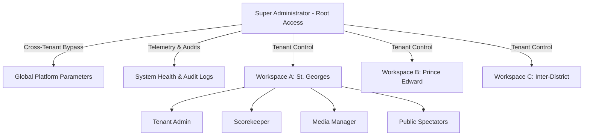
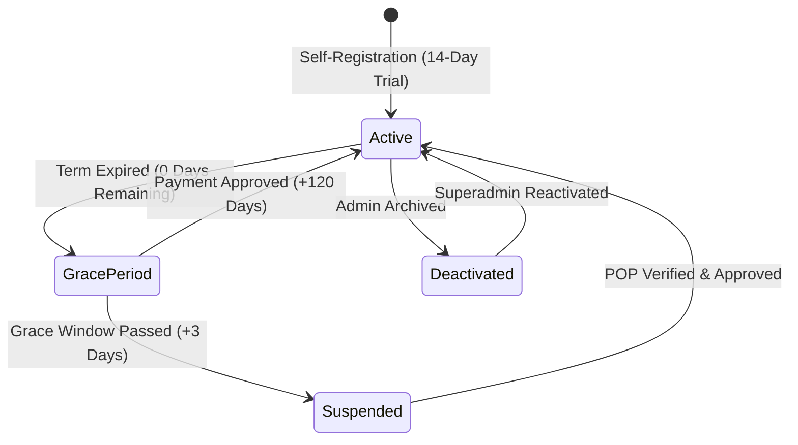

# FixtureGrid Sports Manager — Super Administrator User Manual
**Version:** 2.0 (Enterprise Multi-Tenant Edition)  
**System Classification:** Root Operational Manual  
**Production Portal:** [https://fixturegrid.co.zw](https://fixturegrid.co.zw)  
**Author:** eTechZim Engineering  

---

## Table of Contents
1. [System Overview & Architecture](#1-system-overview--architecture)
2. [Root Authentication & Login Credentials](#2-root-authentication--login-credentials)
3. [Control Tower Dashboard Overview](#3-control-tower-dashboard-overview)
4. [Module 1: Workspaces & Tenant Management](#4-module-1-workspaces--tenant-management)
   - [4.1 Workspace Directory & Status Indicators](#41-workspace-directory--status-indicators)
   - [4.2 Proof of Payment (POP) Verification & Approval](#42-proof-of-payment-pop-verification--approval)
   - [4.3 Extending & Adjusting Expiry Dates](#43-extending--adjusting-expiry-dates)
   - [4.4 Suspending, Deactivating & Reactivating](#44-suspending-deactivating--reactivating)
   - [4.5 One-Click Tenant Impersonation](#45-one-click-tenant-impersonation)
   - [4.6 Resource Quotas & Storage Limits](#46-resource-quotas--storage-limits)
   - [4.7 Provisioning New Tournament Workspaces](#47-provisioning-new-tournament-workspaces)
   - [4.8 Workspace Deletion Safeguards](#48-workspace-deletion-safeguards)
5. [Module 2: Global User Account Administration](#5-module-2-global-user-account-administration)
   - [5.1 Global User Directory & Role Hierarchy](#51-global-user-directory--role-hierarchy)
   - [5.2 Creating Global Administrators & Operators](#52-creating-global-administrators--operators)
   - [5.3 Multi-Workspace Assignment Matrix](#53-multi-workspace-assignment-matrix)
   - [5.4 Direct Password Reset](#54-direct-password-reset)
6. [Module 3: Platform Parameters & Global Configuration](#6-module-3-platform-parameters--global-configuration)
   - [6.1 Subscription Term Defaults](#61-subscription-term-defaults)
   - [6.2 Global Platform Identity & Inquiries](#62-global-platform-identity--inquiries)
   - [6.3 Emergency Maintenance Mode & Banners](#63-emergency-maintenance-mode--banners)
   - [6.4 Public Self-Registration Controls](#64-public-self-registration-controls)
7. [Module 4: System Health, Telemetry & Audit Logs](#7-module-4-system-health-telemetry--audit-logs)
   - [7.1 Real-Time Server Telemetry](#71-real-time-server-telemetry)
   - [7.2 Billing & Expiry Cron Runner](#72-billing--expiry-cron-runner)
   - [7.3 Security Audit Trail & CSV Export](#73-security-audit-trail--csv-export)
8. [Quota Enforcement & Billing Lifecycle](#8-quota-enforcement--billing-lifecycle)
9. [CLI & DevOps Runbook](#9-cli--devops-runbook)

---

## 1. System Overview & Architecture

FixtureGrid operates on an isolated multi-tenant architecture. Every tournament or school exists as an autonomous **Organization / Workspace** with its own:
- Teams, houses, and districts
- Sports disciplines and custom scoring systems
- Match fixtures, field events, and track lane schedules
- Live score feeds, spectator FanZones, and push notifications
- Media assets, sponsor banners, and storage quotas

The **Super Administrator** possesses the highest authorization level across the entire platform. Superadmins bypass tenant boundaries, inspect cross-workspace statistics, manage billing states, configure global parameters, and impersonate workspace accounts for technical support.



---

## 2. Root Authentication & Login Credentials

### 2.1 Default Production Login Credentials
> [!IMPORTANT]
> Keep root credentials strictly confidential. These credentials grant unconstrained administrative access to all organizations and server settings.

| Parameter | Default Value | Notes |
| :--- | :--- | :--- |
| **Login URL** | `https://fixturegrid.co.zw/login` | Direct login portal |
| **Email Address** | `admin@etechzim.co.zw` | Primary Superadmin ID |
| **Password** | `Etechzim2026!` | Initial root password |
| **System Role** | `superadmin` | Bypasses all workspace isolation |

### 2.2 Authentication Flow
1. Navigate to `https://fixturegrid.co.zw/login`.
2. Enter the superadmin email and password.
3. Upon authentication, the system recognizes the `superadmin` role in the JWT token.
4. The navigation sidebar automatically reveals the exclusive **Superadmin** navigation tab (`/superadmin`) with a purple **Root Access** badge.

> [!TIP]
> Superadmins can also access individual tournament workspaces without signing out by using the **Tournament Switcher** at the top-left or via the **Impersonate** button in the Superadmin console.

---

## 3. Control Tower Dashboard Overview

The Superadmin Control Tower is divided into four dedicated administrative modules:

```
┌─────────────────────────────────────────────────────────────────────────────┐
│ 🛡️ Superadmin Control Tower [Root Access]                                   │
├─────────────────┬────────────────────┬─────────────────────┬────────────────┤
│ 🏢 Workspaces   │ 👥 Global Users    │ ⚙️ Platform Settings │ 📈 Health & Log│
└─────────────────┴────────────────────┴─────────────────────┴────────────────┘
```

1. **Workspaces & Tenants**: Complete lifecycle management of schools and tournaments (approvals, quotas, suspensions, impersonation).
2. **Global User Accounts**: Centralized directory of all user profiles across all workspaces with password resets and multi-workspace assignments.
3. **Platform Parameters**: Global defaults (trial days, grace periods, maintenance mode, self-registration).
4. **System Health & Audit Logs**: Live database/Redis telemetry, background scheduler execution, and compliance audit trail with CSV export.

---

## 4. Module 1: Workspaces & Tenant Management

### 4.1 Workspace Directory & Status Indicators
The **Workspaces & Tenants** tab displays every registered tournament workspace on the platform.

```
+---------------------------------------------------------------------------------------+
| Search school name, slug, email...  [All (14)] [Pending (2)] [Active (10)] [Susp (2)]  |
+---------------------------------------------------------------------------------------+
```

Each workspace row displays:
- **Workspace / Customer**: School or tournament name, URL slug (e.g. `/watch/st-georges`), and active event title.
- **Contact Details**: Creator email, billing contact person, phone number, and physical billing address.
- **Status Badge**:
  - `Active` (Green): Full access to schedule, scores, and spectator portals.
  - `Pending POP` (Blue, Pulsing): Customer submitted Proof of Payment receipt awaiting your approval.
  - `Grace Period` (Amber): Subscription expired, currently within the 3-day grace window.
  - `Suspended` (Red): Locked out due to expired license or manual suspension. Public and admin routes blocked.
  - `Deactivated` (Gray): Manually archived; hidden from public tournament lists.
- **Time Remaining**: Days/hours left on the current license subscription.
- **Proof of Payment (POP)**: Clickable link to view uploaded bank transfer/deposit slip receipt with upload timestamp.
- **Action Controls**: Approve, Extend, Edit, Stats, Impersonate, and Suspend/Reactivate.

---

### 4.2 Proof of Payment (POP) Verification & Approval
When a school transfers subscription fees, they upload their bank deposit slip in their billing tab.

#### Approval Procedure:
1. Filter workspaces by clicking the **Pending Review** filter pill.
2. In the **Proof of Payment** column, click **View POP Receipt** to inspect the receipt in a new tab.
3. Verify the transfer amount, reference code, and date.
4. In the **Days** input box next to the **Approve** button, enter the license duration (defaults to `120` days = 1 school term).
5. Click **Approve**.
6. The workspace status immediately changes to `Active`, the expiration timer updates, and an audit log entry is recorded.

---

### 4.3 Extending & Adjusting Expiry Dates
For goodwill extensions, split payments, or special arrangements:
1. In the workspace row, locate the date picker in the **License Actions** column.
2. Select the target expiration date.
3. Click **Extend**.
4. The workspace expiration date is immediately adjusted without altering existing tournament records.

---

### 4.4 Suspending, Deactivating & Reactivating

#### Suspending Access:
- Click **Suspend Access** (Red button).
- Confirm the dialog.
- The tenant is immediately locked. Any tenant admin attempting to log in will see a billing lock screen with an upload link for proof of payment.

#### Deactivating a Workspace:
- Click the **Deactivate** icon.
- A deactivated workspace is hidden from public selection lists (`/`) while preserving all historical match data and athlete scores.

#### Reactivating a Workspace:
- Filter by **Deactivated (Hidden)**.
- Click **Reactivate** (Green button).
- The workspace instantly reappears in tournament lists.

---

### 4.5 One-Click Tenant Impersonation
When a school administrator requests technical assistance:
1. Locate the school in the Workspaces table.
2. Click the **Impersonate** button (`Log In` icon).
3. The platform issues a secure scoped session token and navigates directly to the customer's dashboard (`/?workspace=school-slug`).
4. You now operate with full administrator rights within that school to fix fixtures, adjust scores, or configure lane allocations.
5. To return to the superadmin tower, navigate back to `/superadmin`.

---

### 4.6 Resource Quotas & Storage Limits
Each workspace has configurable quota ceilings to protect server capacity:
- **Max Teams**: Maximum allowed houses or teams (default: `12`).
- **Max Sports**: Maximum simultaneous sports disciplines (default: `10`).
- **Storage Quota (MB)**: Total storage for photo/video uploads and sponsor banners (default: `500 MB`).

#### Modifying Tenant Quotas:
1. Click the **Edit** button (`Pencil` icon) on the workspace row.
2. Adjust **Max Teams**, **Max Sports**, or **Storage Quota (MB)**.
3. Toggle **Maintenance Mode** for that specific workspace if they are undergoing major schedule re-generation.
4. Click **Save Changes**.

---

### 4.7 Provisioning New Tournament Workspaces
To onboard a school manually:
1. Click **+ New Workspace** in the top-right corner.
2. Fill in the modal fields:
   - **School / Organization Name**: e.g., `Chisipite Senior School`
   - **URL Slug**: e.g., `chisipite` (auto-generated, must be unique)
   - **Event Title**: e.g., `Inter-House Track & Swimming Gala 2026`
   - **Administrator Email**: e.g., `sports@chisipite.co.zw`
   - **Administrator Password**: Temporary password for the sports director
   - **Initial Term (Days)**: e.g., `120`
   - **Resource Quotas**: Max teams, sports, and storage limits.
3. Click **Provision Workspace**.
4. The workspace, database partitions, and admin user are provisioned in under 1 second.

---

### 4.8 Workspace Deletion Safeguards
- Workspace deletion is permanent and deletes all associated fixtures, scores, results, and uploaded files.
- The primary default tenant (ID `1`) is hard-coded with deletion protection and cannot be deleted.
- A confirmation prompt is mandatory before any deletion executes.

---

## 5. Module 2: Global User Account Administration

The **Global User Accounts** tab provides visibility and control over every account registered in the system.

```
+---------------------------------------------------------------------------------------+
| Search user name or email...   [All Roles v]   [Filter by Workspace v]   [+ Add User] |
+---------------------------------------------------------------------------------------+
```

### 5.1 Role Hierarchy & Permissions

| Role | Scope | Key Capabilities |
| :--- | :--- | :--- |
| **Superadmin** | Global (All Tenants) | Full platform control, billing, quotas, server health, impersonation. |
| **Admin** | Workspace-Scoped | Schedule generation, venue creation, team management, billing receipt uploads. |
| **Scorekeeper** | Workspace-Scoped | Real-time score entry, stopwatch lane timing, distance logging. Cannot change settings. |
| **Media Manager** | Workspace-Scoped | FanZone photos, video story clips, sponsor logos, advert banners. |

---

### 5.2 Creating Global Administrators & Operators
1. In the **Global User Accounts** tab, click **+ Add User**.
2. Select the **Primary Workspace**.
3. Enter Name, Email Address, and Initial Password.
4. Select the **Role** (`Superadmin`, `Admin`, `Scorekeeper`, `Media Manager`).
5. Click **Create User**.

---

### 5.3 Multi-Workspace Assignment Matrix
A sports coordinator who manages tournaments across multiple campuses can be granted access to multiple workspaces:
1. In the user row, click **Manage Workspaces** (`Building` icon).
2. The modal displays checkboxes for all available tournament workspaces.
3. Check all workspaces the user is permitted to manage.
4. Click **Save Workspace Assignments**.
5. When the user logs in, the **Tournament Switcher** allows them to switch between assigned schools seamlessly.

---

### 5.4 Direct Password Reset
If a school official forgets their password:
1. Locate the user in the directory.
2. Click **Reset Password** (`Key` icon).
3. Enter the new password (or generate a secure random one).
4. Click **Update Password**.
5. The password updates instantly with secure bcrypt hashing (cost factor 10).

---

## 6. Module 3: Platform Parameters & Global Configuration

The **Platform Parameters** tab controls platform-wide defaults, billing policies, and emergency controls.

```
+---------------------------------------------------------------------------------------+
| 💳 Subscription & License Terms    🌐 Platform Identity & Support    🛡️ Access & Maint  |
+---------------------------------------------------------------------------------------+
```

### 6.1 Subscription Term Defaults
- **Default Trial Term (Days)**: Initial active days granted when a school self-registers (default: `14` days).
- **Approved Term Extension (Days)**: Standard duration added upon approving a payment receipt (default: `120` days).
- **Grace Period Duration (Days)**: Buffer period between license expiration and full account suspension (default: `3` days).

---

### 6.2 Global Platform Identity & Inquiries
- **Platform Brand Name**: Displayed on header titles and public banners (e.g. `FixtureGrid`).
- **Support / Billing Inquiries Email**: Shown on customer invoices and billing inquiry prompts (e.g. `billing@fixturegrid.co.zw`).

---

### 6.3 Emergency Maintenance Mode & Banners
When performing major server upgrades, database maintenance, or emergency schema updates:
1. Toggle **Global Maintenance Mode** to `ON`.
2. Enter the **Maintenance Notice Message** (e.g., *"Scheduled platform upgrade in progress. Normal service resumes at 15:00 CAT."*).
3. Click **Save All Settings**.
4. **Behavior**:
   - All standard users, scorekeepers, and public visitors are gated with a maintenance screen.
   - **Superadministrators bypass maintenance mode entirely**, allowing full testing before reopening the site.
5. To reopen, uncheck the toggle and save.

---

### 6.4 Public Self-Registration Controls
- **Allow Self-Registration for New Workspaces**: When checked, schools can create their own workspace from the public landing page.
- When unchecked, new schools can only be provisioned by the Superadmin team.

---

## 7. Module 4: System Health, Telemetry & Audit Logs

The **System Health & Audit Logs** tab provides infrastructure observability and operational governance.

### 7.1 Real-Time Server Telemetry
Telemetry cards poll every 30 seconds:
- **Database Size & Connectivity**: Total PostgreSQL database footprint and pool connection status.
- **Node.js Memory Utilization**: Active RSS memory, V8 heap usage, and memory pressure.
- **Process Uptime**: Continuous running time of the PM2 production service.
- **Redis Cache Key Status**: Number of active cached leaderboards and fixture query keys.

---

### 7.2 Billing & Expiry Cron Runner
While the background scheduler automatically checks expirations every hour, you can trigger an immediate check:
1. Click **Run Billing Check Now** (`Play` icon).
2. The system evaluates all tenant expiration dates, advances expired tenants into grace period, suspends overdue tenants, and dispatches renewal reminder notices.
3. A summary toast displays the count of evaluated tenants.

---

### 7.3 Security Audit Trail & CSV Export
Every administrative action is immutably recorded in the `superadmin_audit_logs` table:
- **Timestamp** (ISO 8601)
- **Actor Name & Email**
- **Action Type** (`APPROVE_SUBSCRIPTION`, `SUSPEND_TENANT`, `EXTEND_SUBSCRIPTION`, `IMPERSONATE_TENANT`, `RESET_PASSWORD`, etc.)
- **Target Entity** (Workspace or User ID)
- **JSON Metadata**: Pre-change and post-change details
- **IP Address**: Origin IP of the superadmin request

#### Exporting to CSV:
Click **Export Audit CSV** in the top-right corner to download a timestamped spreadsheet (`superadmin-audit-logs-YYYY-MM-DD.csv`) for billing audits or compliance reviews.

---

## 8. Quota Enforcement & Billing Lifecycle



### Quota Enforcement Thresholds
- **Warning Threshold (80%)**: When a workspace reaches 80% of teams or sports, warning banners appear on their dashboard.
- **Hard Ceiling (100%)**: Creation of new teams or sports is blocked with a prompt to contact the superadmin for an upgrade.
- **Storage Limit**: Uploads that would exceed the storage quota are rejected with a clear message showing current usage vs limit.

---

## 9. CLI & DevOps Runbook

For server engineers managing the underlying Linux infrastructure:

### Server Information
- **VPS Host**: `212.90.121.97`
- **Port**: `22` (SSH)
- **Application Directory**: `/var/www/sports-fixture-manager`
- **Process Manager**: PM2 (`kalife-backend`, App ID: `4`)

### Useful Commands
```bash
# Check PM2 process status
pm2 status kalife-backend

# Stream live backend logs
pm2 logs kalife-backend --lines 100

# Restart backend process
pm2 restart kalife-backend

# Run automated deployment from local machine
node server/deploy-remote.js

# Test live API health
curl -I https://fixturegrid.co.zw/api/public/events/demo-tournament
```

---
*End of Super Administrator User Manual. For technical support, contact the eTechZim Engineering Team.*
